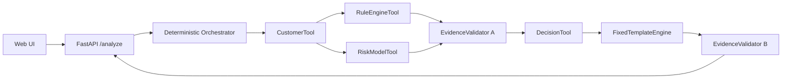

# CreditPilot V0.1

CreditPilot 是一个可本地运行的信贷风险解释与模拟策略决策支持 Copilot。它使用确定性 Python 工具分析原创合成客户，输出可追溯的规则结果、透明演示评分、模拟策略原因和经过一致性校验的中文解释。

> **Demo Only / Synthetic Data**
>
> 本项目只使用 100% 原创合成数据、虚构演示规则和虚构评分参数。它不是银行审批系统，不提供真实授信、额度或客户通知建议，也不具备经验证的真实信用风险预测效力。

## 项目解决什么问题

CreditPilot 展示如何把“为什么得到这个模拟结果”拆成可复核的工程链路：客户快照、四条规则执行记录、六项评分贡献、策略原因、证据引用及固定模板解释。LLM 不参与评分、规则或决策；当前版本也未接入任何真实 LLM。

## 核心功能

- 精确查询 30 条可复现的合成客户记录
- 执行四条不短路的原创模拟规则并记录命中与未命中结果
- 计算 0–1000 的透明演示评分及六项贡献，高分表示较低演示风险
- 区分 Policy Decision Reason、Model Risk Factor 与 Business Guidance
- 通过 EvidenceValidator 阶段 A 重算并校验工具证据，阻断协同篡改
- 通过阶段 B 校验结构化解释事实槽位，失败时不发布候选解释
- 提供 `GET /health`、`POST /analyze` 与同源中文 Web 演示界面
- 全程支持 `rules` 离线模式；`llm` 模式明确未启用

## 系统架构



工具链顺序由代码固定，调用方不能提交已验证报告或决策结果。详细设计见[公开架构说明](docs/public/architecture.md)。

## 技术栈

- Python 3.11、uv
- FastAPI、Pydantic、Uvicorn
- 原生 HTML、CSS、JavaScript
- pytest、HTTPX TestClient、Ruff

## 快速开始（Windows PowerShell）

```powershell
git clone <your-repository-url>
cd CreditPilot
uv sync
uv run uvicorn creditpilot.main:app --reload
```

打开 `http://127.0.0.1:8000/`。健康检查位于 `http://127.0.0.1:8000/health`。

## Web 演示步骤

1. 使用 `DEMO-0001` 查看 `PASS`、935 分、LOW；页面文案为“未触发模拟拒绝规则”，不表示真实授信批准。
2. 使用 `DEMO-0002` 查看 `R001` 命中及规则拒绝原因；869 分 LOW 仍不改变规则拒绝结果。
3. 输入 `DEMO-9999` 查看 `NOT_FOUND`，输入不符合 `DEMO-0000` 格式的编号查看 `INVALID_INPUT`。
4. 展开规则、评分因素、阶段 A/B 摘要、证据引用和原始 JSON；可复制或下载 JSON。

默认数据没有预置“仅评分门槛拒绝”客户，该场景由独立测试夹具验证，不能用虚构编号演示。完整步骤见[演示手册](docs/public/demo_guide.md)。

## API 使用示例

```powershell
$body = @{
  customer_id = "DEMO-0001"
  question = "请解释该合成客户的模拟风险结果"
  mode = "rules"
} | ConvertTo-Json

Invoke-RestMethod `
  -Method Post `
  -Uri "http://127.0.0.1:8000/analyze" `
  -ContentType "application/json" `
  -Body $body
```

业务上的模拟 `REJECT` 返回 HTTP 200；非法输入返回 422，不存在客户返回 404。HTTP 错误与模拟策略状态不会混用。

## 证据验证与决策可信机制

- 阶段 A 不信任工具自报的 `VALID`：它以可信客户快照调用冻结的规则与评分实现重算，核对版本、证据 ID、规则结果、贡献之和与等级。
- `DecisionTool` 只接受当前进程内由阶段 A 实际签发、未被修改且与本次结果绑定的原始报告对象。
- 阶段 B 对白名单模板的结构化事实槽位进行确定性校验；它不是通用自由文本语义验证器。
- 进程内对象授权不是跨进程签名、远程证明或持久化安全凭证；当前设计只适用于本地演示进程。

## 自动化测试

```powershell
uv run pytest -q
uv run ruff check .
```

测试覆盖数据契约、规则与评分边界、S1–S5 手算样例、阶段 A/B 篡改阻断、策略状态、API 和 Web 静态/映射逻辑。Web 自动化不等同于真实浏览器端到端验收。详见[测试与工程证据](docs/public/testing.md)。

## 安全边界与已知限制

- 不含真实客户、征信、银行接口、私有机构规则或业务写操作
- 不读取或向前端暴露 API Key；不调用外部网络或真实 DeepSeek API
- `rules` 是当前唯一可执行模式；`llm` 返回明确的不可用状态
- 无生产数据库、身份认证、RAG、MCP、LangGraph 或多 Agent
- 演示评分不代表违约概率，不提供 AUC、KS 或真实预测准确率
- 本轮未执行真实浏览器人工验收，也没有公开部署地址或产品截图

## 项目路线图

- 当前 V0.1：确定性分析链路、双阶段证据校验、固定模板解释、FastAPI 与本地 Web
- 后续候选：在保持确定性决策边界的前提下，评估 Mock/可选 LLM 表达层与更完整的公开演示评估
- 生产化能力、真实数据接入和真实授信决策不属于 V0.1 范围

## 开源许可证

Copyright 2026 Jack Wang

本项目采用 [Apache License 2.0](LICENSE)。第三方依赖分别受其自身许可证约束。
