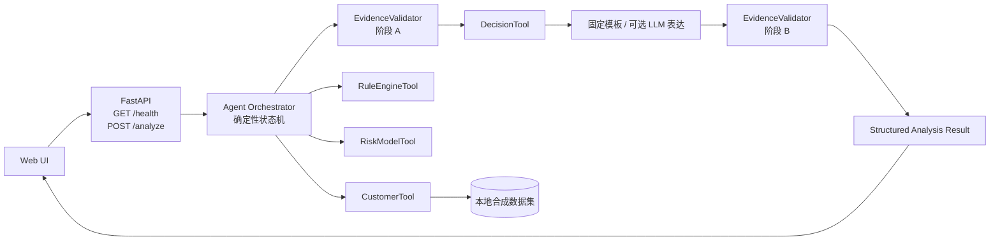
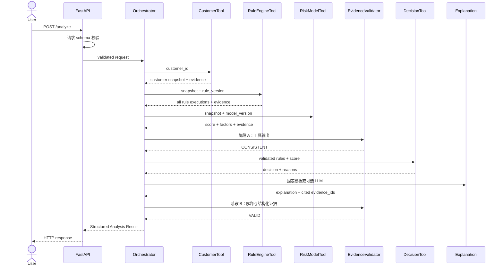
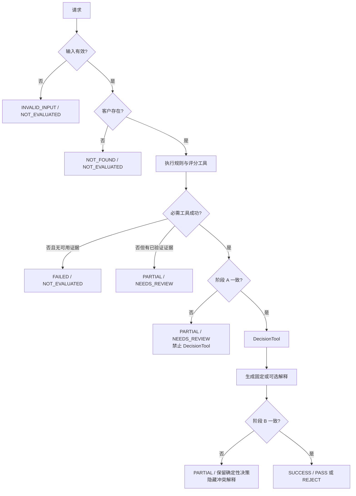

# CreditPilot V0.1 系统架构设计

- 任务编号：CP-02
- 状态：待架构审核
- 产品基线：提交 `216e64c` 中冻结的 PRD 与验收设计
- 约束：本文仅定义设计，不表示相关组件已经实现。

## 1. 设计目标与边界

V0.1 使用单体 FastAPI 应用、确定性顺序编排和本地合成数据，提供可追溯的模拟风险分析。D01–D06 是已批准冻结决策，不在本设计中重新讨论。

不引入 LangGraph、MCP、RAG、多 Agent、生产数据库或真实外部信贷服务。所有工具只读或纯计算。LLM 是可选表达层，不得计算规则、分数或决策，不得改变结构化结果。

## 2. 组件架构

| 组件 | 责任 | 确定性要求 |
|---|---|---|
| Web UI | 展示双状态、三类输出、规则摘要与证据 | 不计算、不改写后端结果 |
| FastAPI | Pydantic 校验、HTTP 映射、关联 ID | 确定性 |
| Agent Orchestrator | 按固定依赖图调用白名单工具 | 确定性；LLM 不控制必需步骤 |
| CustomerTool | 精确读取合成客户快照 | 确定性、只读 |
| RuleEngineTool | 执行全部冻结规则并记录命中/未命中 | 确定性、纯计算 |
| RiskModelTool | 计算演示分数、等级和因素贡献 | 确定性、纯计算 |
| EvidenceValidator | 阶段 A 工具证据及阶段 B 解释一致性校验 | 确定性、纯计算 |
| DecisionTool | 在有效规则与评分上执行冻结策略 | 确定性、纯计算 |
| 可选 LLM | 意图辅助与非实质性表达 | 只能引用已验证结果，可完全降级 |

## 3. 正常数据流

固定顺序不得改变：工具执行 → 工具证据校验 → 确定性策略计算 → 可选 LLM 解释 → 最终解释校验 → Web 展示。RuleEngineTool 与 RiskModelTool 可由实现选择顺序执行或并行纯计算，但必须全部完成且通过阶段 A 后才能调用 DecisionTool。

## 4. 异常流程

技术失败永远不能映射为 `REJECT`。必需依赖失败或阶段 A 不一致时禁止发布最终 `PASS` / `REJECT`。阶段 B 只影响解释发布：已完成且验证过的确定性决策可保留，但整体分析为 `PARTIAL`，冲突解释不展示。

Web 在同一分析中独立展示四项信息，避免 D01 文案掩盖评分策略：规则命中数/规则总数、`P_SCORE_001` 评分门槛是否满足、演示分数与等级、完整模拟策略结果。内部 `PASS` 仍只映射为冻结文案“未触发模拟拒绝规则”，并始终显示“非真实授信结果”免责声明。

## 5. 编排状态机

| 阶段 | 进入条件 | 成功出口 | 失败出口 |
|---|---|---|---|
| VALIDATE_REQUEST | 收到请求 | LOAD_CUSTOMER | INVALID_INPUT |
| LOAD_CUSTOMER | 请求有效 | RUN_TOOLS | NOT_FOUND / FAILED |
| RUN_TOOLS | 客户快照有效且必需字段齐全 | VALIDATE_TOOL_EVIDENCE | PARTIAL/FAILED |
| VALIDATE_TOOL_EVIDENCE | 规则和评分结果存在 | RUN_DECISION | PARTIAL + NEEDS_REVIEW |
| RUN_DECISION | 阶段 A 为 CONSISTENT | BUILD_EXPLANATION | PARTIAL/FAILED |
| BUILD_EXPLANATION | 决策结果存在 | VALIDATE_EXPLANATION | 固定模板降级或 PARTIAL |
| VALIDATE_EXPLANATION | 解释带引用 | COMPLETE | PARTIAL，隐藏解释 |
| COMPLETE | 可发布结果已形成 | SUCCESS | 不适用 |

编排器使用显式 Python 分支，不让 LLM 选择下一必需工具。工具白名单仅含 `CustomerTool`、`RuleEngineTool`、`RiskModelTool`、`DecisionTool` 和 `EvidenceValidator`。

## 6. API 概要

### GET /health

保持 CP-00 已有契约：HTTP 200，返回 `status`、`app`、`version`、`mode`。

### POST /analyze

请求包含 `customer_id`、`question`、`mode`。`mode=rules` 必须完全离线；`mode=llm` 可选且测试只能使用 Mock。详细 schema、HTTP 映射和错误结构见 [工具与 API 契约](tool_contracts_v01.md)。

## 7. 输出分层

Structured Analysis Result 必须分别包含：

1. Policy Decision Reason：仅来自 DecisionTool 的规则/策略执行记录。
2. Model Risk Factor：仅来自 RiskModelTool 的公式贡献。
3. Business Guidance：固定模板，不由 LLM 实质性改写。

Web 对内部 `PASS` 只显示“未触发模拟拒绝规则”。默认展示命中规则与规则总数，可展开所有规则执行记录。

阶段 A 必须核对 customer_id、data_version、规则/模型版本、源字段值、四条规则执行结果、六项评分贡献、总分与等级；任何必需项失败都阻断 DecisionTool。阶段 B 必须核对解释中的分数、等级、规则命中、原因 ID、因素贡献、版本和 evidence_id。EvidenceValidator 只能报告和阻断，不能补值、选择冲突一方或自行修复。

## 8. 追踪关系

| 架构能力 | FR | 主要 AC |
|---|---|---|
| 客户加载 | FR-01 | AC-001、002、006、007、011 |
| 规则与版本 | FR-02 | AC-003、008、009、010 |
| 评分与因素 | FR-03 | AC-004、005、007 |
| 策略决策 | FR-04 | AC-001、002、005、009、010 |
| 受控编排 | FR-05 | AC-009、011、012、013 |
| 两阶段证据校验 | FR-06 | AC-003、005、010 |
| 失败降级 | FR-07 | AC-006、007、009、013 |
| 结构化展示 | FR-08 | AC-001、002、005、010、012 |

## 9. 相关设计

- [合成数据契约](data_contracts_v01.md)
- [评分与模拟策略](risk_policy_v01.md)
- [工具、状态、证据与 API 契约](tool_contracts_v01.md)
- [测试设计](test_design_v01.md)
