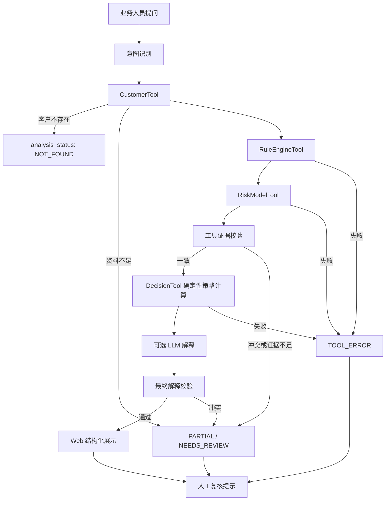

# CreditPilot V0.1 产品需求文档

- 文档版本：V0.1
- 任务编号：CP-01 / CP-01A / CP-01B
- 状态：FROZEN — CreditPilot V0.1 Requirements Baseline
- 决策批准角色：Product Owner
- 批准依据：CP-01B 本次明确授权
- 冻结范围：产品需求、验收标准、状态语义、业务边界
- CP-02 待设计事项：评分公式、等级阈值、字段清单、错误码、证据契约
- 说明：本文定义规划需求，不表示相关功能已经实现。

## 1. 产品定位与业务价值假设

CreditPilot 是 AI 信贷风险解释与决策辅助 Copilot，面向模拟信贷业务人员和风控分析师。用户可用自然语言查询原创合成客户数据；系统通过确定性风险规则和演示评分工具生成结构化、可追溯的风险解释及人工复核提示。

核心价值假设是：将策略结果、模型因素及其证据以一致结构呈现，能够降低业务人员理解模拟风险结果的成本。CreditPilot 帮助用户理解“模拟客户为什么得到某个风险结果”，LLM 不负责授信审批。

### 1.1 演示声明

- 数据为 100% 原创合成数据。
- 规则、阈值、权重和评分参数为 100% 虚构演示设计。
- 无真实客户、真实征信、真实银行接口或真实业务写操作。
- 不执行真实审批、授信、额度调整或客户通知。
- 不复制前雇主的私有数据、模型、参数或策略。
- 演示模型不具备且不宣称具有真实预测效力。

## 2. 目标用户

| 角色 | 主要目标 | V0.1 权限边界 |
|---|---|---|
| 信贷业务人员 | 查询模拟客户并理解结果、证据和下一步资料要求 | 只读查询和解释，不执行审批或通知 |
| 风控分析师 | 核对规则版本、阈值、评分因素和证据一致性 | 分析演示规则与评分，不调整线上策略 |
| 风控经理 | 查看结构化结论、异常和人工复核提示 | 做演示审核，不形成真实授信决定 |

## 3. 用户故事

- US-01：作为信贷业务人员，我希望查询一个模拟客户，以便看到其合成资料与当前分析状态。
- US-02：作为风控分析师，我希望查看命中规则及版本，以便复核结果能否重现。
- US-03：作为风控分析师，我希望查看演示评分及关键因素，以便理解因素如何影响模拟风险结果。
- US-04：作为信贷业务人员，我希望区分策略拒绝原因和模型风险因素，以免错误归因。
- US-05：作为风控经理，我希望每项关键结论都有证据来源，以便进行人工复核。
- US-06：作为任一用户，我希望资料不足、工具失败或证据冲突被明确标记，而不是得到编造的确定结论。
- US-07：作为业务人员，我希望用自然语言提出问题，并获得受控、结构化的只读分析。
- US-08：作为风控经理，我希望在 Web 页面分别查看决策原因、模型因素和业务说明。

优先问题包括：为什么某模拟客户被拒绝、风险评分和关键因素是什么、命中了哪些规则及证据来源、模型因素为何可能不同于策略拒绝原因，以及系统如何处理资料不足、工具异常和证据冲突。`DEMO-0001`、`DEMO-0002` 仅是问题示例，CP-01 不预设其数据或结果。

## 4. V0.1 功能范围

下列 FR 均为待后续任务实现和验证的需求。

### FR-01 模拟客户查询

- 用户角色：信贷业务人员、风控分析师、风控经理。
- 业务价值：为后续计算提供唯一、可追溯的合成客户快照。
- 前置条件：CP-03 已生成合成数据集及数据版本；客户编号符合公开格式。
- 输入：模拟客户编号。
- 处理逻辑：确定性校验编号；只读查找精确记录；返回数据版本、字段可用性和来源标识。
- 输出：客户编号、脱敏的合成画像、缺失字段、数据版本和查询状态。
- 异常情况：非法编号的 `analysis_status` 为 `INVALID_INPUT`；不存在为 `NOT_FOUND`；关键字段缺失时分析可为 `PARTIAL`，且不得生成确定性决策。
- 可验证验收标准：相同数据版本下精确返回同一记录；不得模糊匹配或生成客户；不存在时不得调用下游决策工具。
- 关联测试场景：AC-001、AC-002、AC-006、AC-007、AC-011。

### FR-02 规则命中与版本追溯

- 用户角色：风控分析师、风控经理。
- 业务价值：解释哪些虚构规则被命中，并支持复现。
- 前置条件：客户快照有效；演示规则集已加载且有唯一版本。
- 输入：客户快照、数据版本、规则集版本。
- 处理逻辑：由确定性 RuleEngineTool 逐条计算条件和边界，保存输入字段、比较符、阈值、实际值及命中结果。
- 输出：规则执行记录、命中列表、规则版本、证据引用。
- 异常情况：版本不存在、字段缺失或规则执行失败时不得推测命中，返回明确错误或 `NEEDS_REVIEW`。
- 可验证验收标准：同输入和规则版本结果一致；每个命中均有规则 ID 和证据；阈值等于边界时按规则定义得到唯一结果。
- 关联测试场景：AC-001、AC-002、AC-003、AC-007、AC-008、AC-009、AC-010。

### FR-03 演示风险评分与风险因素

- 用户角色：风控分析师、风控经理。
- 业务价值：展示可复现的演示评分及其因素贡献。
- 前置条件：评分所需字段满足最低完整性要求；模型版本有效。
- 输入：客户快照、演示模型版本。
- 处理逻辑：RiskModelTool 使用确定性 Python 公式计算 0–1000 分的演示分数、三级风险等级和因素贡献；分数越高代表演示风险越低。具体公式和等级阈值在 CP-02 冻结，禁止 LLM 计算或补值。
- 输出：演示分数、等级、模型版本、Model Risk Factor 列表及证据引用。
- 异常情况：关键特征缺失返回 `UNKNOWN` 或 `NEEDS_REVIEW`；版本错误或计算失败返回工具错误。
- 可验证验收标准：同输入和版本产生同分数；分数在 0–1000 范围且高分方向一致；因素贡献可追溯；输出明确标记“演示评分，不代表真实违约概率”；因素不得自动写成拒绝原因。
- 关联测试场景：AC-002、AC-004、AC-005、AC-007、AC-009、AC-010。

### FR-04 模拟策略决策解释

- 用户角色：信贷业务人员、风控分析师、风控经理。
- 业务价值：解释确定性模拟策略结果，而不是让 LLM 作决定。
- 前置条件：规则结果和评分结果均有效，其工具证据已校验，且相应版本一致。V0.1 完整模拟策略结果依赖这两项必需结果。
- 输入：规则结果、演示评分结果、策略版本。
- 处理逻辑：DecisionTool 按确定性虚构策略生成 `PASS`、`REJECT` 或 `NEEDS_REVIEW`；解释只引用实际执行记录。
- 输出：模拟策略状态、Policy Decision Reason、策略版本、证据和人工复核标记。
- 异常情况：任一必需依赖失败、证据不足或冲突、版本未知时，不对外发布最终 `PASS` / `REJECT`；`decision_status` 为 `NEEDS_REVIEW` 或 `NOT_EVALUATED`，允许保留明确标注的已验证部分证据。
- 可验证验收标准：拒绝原因必须来自实际命中的决策规则；通过结果不得捏造拒绝原因；模型因素与策略原因分栏输出。
- 关联测试场景：AC-001、AC-002、AC-003、AC-005、AC-007、AC-008、AC-009、AC-010。

### FR-05 Agent 自然语言查询与受控工具调用

- 用户角色：信贷业务人员、风控分析师、风控经理。
- 业务价值：降低查询门槛，同时把计算限制在受控工具中。
- 前置条件：用户问题处于允许的只读演示范围；工具注册表可用。
- 输入：自然语言问题及可选模拟客户编号。
- 处理逻辑：LLM 可做意图识别、参数抽取、工具编排和基于已验证证据的表达；客户、规则、评分和决策结果必须来自工具；只允许白名单只读调用。
- 输出：结构化解释、调用状态、证据引用、限制声明和人工复核提示。
- 异常情况：意图不清请求澄清；提示注入或越权请求被拒绝；LLM 超时返回明确失败，不伪装成功。
- 可验证验收标准：计算值均可映射到工具输出；不得调用未授权工具或网络；恶意提示不能改变系统边界或伪造结论。
- 关联测试场景：AC-001、AC-004、AC-006、AC-009、AC-011、AC-012、AC-013。

### FR-06 证据一致性校验

- 用户角色：风控分析师、风控经理。
- 业务价值：阻止版本混用、无来源结论和相互矛盾的解释。
- 前置条件：各工具返回结构化结果与证据元数据。
- 输入：客户、规则、评分、决策、可选 LLM 解释及其版本、引用和状态。
- 处理逻辑：先对各工具结果执行确定性证据校验，只有有效规则结果和有效评分结果才能进入策略计算；可选 LLM 解释生成后再次校验其结论与引用，合格后才允许展示。
- 输出：`CONSISTENT` 或 `INCONSISTENT`、冲突明细、可发布结论范围。
- 异常情况：缺少证据元数据按不完整处理；工具证据冲突时停止策略计算或发布受影响的确定性结论；解释冲突时停止发布受影响解释。
- 可验证验收标准：人为构造的 ID、版本或值冲突可被检出；冲突输出 `NEEDS_REVIEW` 并指出冲突位置。
- 关联测试场景：AC-003、AC-005、AC-007、AC-010。

### FR-07 资料缺失与工具失败处理

- 用户角色：全部角色。
- 业务价值：让失败可见并避免错误自动决策。
- 前置条件：系统使用统一状态和错误结构。
- 输入：缺失字段、客户不存在、超时、工具错误或部分结果。
- 处理逻辑：按错误类别停止依赖链或保留经验证的部分结果；确定结论只基于充分证据；提供非决策性的下一步说明。
- 输出：独立的 `analysis_status` 与 `decision_status`、安全错误码、已验证部分证据及安全错误摘要。`TOOL_ERROR`、`UNKNOWN` 等不作为两类主状态混用。
- 异常情况：错误详情可能含敏感内容时仅记录安全错误码和关联 ID。
- 可验证验收标准：失败不得返回成功状态；工具失败不得被 LLM 补全；不存在客户不得生成画像；缺失字段列表可验证。
- 关联测试场景：AC-006、AC-007、AC-009、AC-010、AC-013。

### FR-08 Web 结构化分析展示

- 用户角色：全部角色。
- 业务价值：以清晰分区减少将模型因素误认为拒绝原因的风险。
- 前置条件：后端返回经校验的结构化响应。
- 输入：结构化分析结果和状态。
- 处理逻辑：只渲染后端证据；把三类输出和异常状态分区展示；默认显示命中规则及规则总数，允许展开全部规则执行记录；显示版本、来源、演示标签及人工复核提示。
- 输出：Policy Decision Reason、Model Risk Factor、Business Guidance 三个独立区域及证据区域。
- 异常情况：部分工具失败时可以展示已验证的部分证据，但整体 `analysis_status` 必须为 `PARTIAL` 或 `FAILED`，决策不得伪装成功。
- 可验证验收标准：三类输出具有不同标题和结构；内部 `PASS` 在 Web 仅展示“未触发模拟拒绝规则”；默认规则摘要及展开详情符合 D05；异常醒目可见；页面不得提供真实审批、额度调整或通知操作。
- 关联测试场景：AC-001、AC-002、AC-005、AC-007、AC-009、AC-010、AC-012。

## 5. 三类输出定义

| 类型 | 唯一来源 | 最小结构 | 禁止事项 |
|---|---|---|---|
| Policy Decision Reason | DecisionTool 的确定性模拟策略与规则执行记录 | 原因 ID、说明、关联规则 ID、证据引用、策略版本 | 不得从模型因素或 LLM 推测拒绝原因 |
| Model Risk Factor | RiskModelTool 的演示评分计算 | 因素 ID、方向、贡献/影响、证据引用、模型版本 | 不得自动等同于策略拒绝原因 |
| Business Guidance | 基于已验证状态选择的固定模板 | 模板 ID、指引类型、固定说明、依据引用、免责声明 | LLM 不得改写实质性业务建议；不得冒充正式授信建议、审批意见或客户通知 |

报告、API 数据结构和 Web 展示必须保持这三类输出独立。Business Guidance 使用固定、可测试的模板，只能建议补充资料、核对证据或人工复核，不得建议真实批准、拒绝或调整额度。

### 5.1 状态语义

两类状态必须独立表达，禁止用错误码替代主状态：

| 字段 | 枚举值 | 语义 |
|---|---|---|
| `analysis_status` | `SUCCESS` | 所需分析步骤及证据校验成功 |
| `analysis_status` | `PARTIAL` | 仅部分证据有效或非决策步骤失败，结果明确降级 |
| `analysis_status` | `FAILED` | 分析无法产生可发布结果 |
| `analysis_status` | `NOT_FOUND` | 合法客户编号不存在 |
| `analysis_status` | `INVALID_INPUT` | 请求未通过输入校验 |
| `decision_status` | `PASS` | 仅表示模拟策略未触发拒绝；Web 展示“未触发模拟拒绝规则” |
| `decision_status` | `REJECT` | 仅表示模拟策略触发虚构拒绝条件 |
| `decision_status` | `NEEDS_REVIEW` | 已进入评估但因缺失、失败或冲突不能发布 PASS/REJECT |
| `decision_status` | `NOT_EVALUATED` | 未进入或无法开始策略计算 |

`TOOL_ERROR`、`UNKNOWN`、`CONSISTENT`、`INCONSISTENT` 等仅作为稳定错误码、证据状态或补充字段使用，具体契约由 CP-02 定义。

## 6. 端到端业务流程

- 允许 LLM 参与：意图识别、合法参数抽取、白名单工具编排，以及在证据约束下组织自然语言。
- 必须确定性：客户查找、规则计算、评分计算、策略决策、证据一致性校验和状态选择。
- 必须拒绝编造：客户不存在、工具无返回、证据缺失或冲突、版本不可用时，LLM 不得补充事实或结果。
- 工具失败：停止所有依赖该结果的步骤；可展示已验证部分证据，但整体分析标记 `PARTIAL` 或 `FAILED`，错误码可为 `TOOL_ERROR`。
- 客户不存在：`analysis_status=NOT_FOUND`、`decision_status=NOT_EVALUATED`，不得创建临时画像或继续计算。
- 证据不一致：列出冲突并停止发布受影响的确定性结论；已进入评估时 `decision_status=NEEDS_REVIEW`。
- 固定顺序：工具执行 → 工具证据校验 → 确定性策略计算 → 可选 LLM 解释 → 最终解释校验 → Web 展示。

## 7. 数据与决策边界

每次分析绑定客户 ID、数据版本、规则版本、模型版本和策略版本。关键结论必须引用具体的合成字段或工具执行记录。所有状态仅表示演示流程结果，不对应真实信用资格。系统不持有真实密钥或真实客户资料，不向真实业务系统写入数据。

## 8. 非功能需求

| ID | 需求 |
|---|---|
| NFR-01 | 默认离线运行；测试不得依赖真实网络或 LLM。 |
| NFR-02 | 相同输入、数据和工具版本必须产生相同风险计算结果。 |
| NFR-03 | API 输入输出使用 Pydantic 严格校验，并拒绝非法客户编号。 |
| NFR-04 | 所有关键结论具有可定位的证据来源和版本。 |
| NFR-05 | LLM 或工具失败不得伪装为成功。 |
| NFR-06 | 关键异常返回明确、稳定且机器可判定的状态。 |
| NFR-07 | API Key 仅由服务端环境变量管理，不输出到响应或日志。 |
| NFR-08 | 日志不记录完整客户画像、敏感字段或提示内容中的秘密。 |
| NFR-09 | 固定样例和版本的离线测试可复现。 |
| NFR-10 | README 必须区分已实现功能与规划功能。 |

## 9. 不在 V0.1 范围内

- 真实信贷审批、客户数据、征信接口或银行接口
- 生产数据库集成
- RAG、多 Agent 协作、LangGraph 或 MCP
- Docker 生产部署
- 自动策略调整
- 真实模型训练、效果验证或预测效力声明
- 真实授信、额度调整、客户通知或其他业务写操作

## 10. 后续版本规划

未来可在单独审批后评估权限体系、审计留痕、更多合成场景和部署方式。任何生产数据、外部系统集成、模型训练或自动决策能力均须重新进行合规、安全及产品立项，不属于 V0.1 承诺。

## 11. 已批准并冻结的产品决策

| ID | 状态 | 冻结决策 |
|---|---|---|
| D01 | APPROVED | 内部 `PASS` 仅表示模拟策略未触发拒绝；Web 展示“未触发模拟拒绝规则”，不得表述为真实授信批准。 |
| D02 | APPROVED | 演示评分为 0–1000，分数越高代表演示风险越低，采用三级风险等级；不代表真实违约概率，公式和阈值在 CP-02 冻结。 |
| D03 | APPROVED | 必需字段是规则、评分或完整策略计算不可缺少的输入；缺失时不得生成确定性结论。可选字段仅补充画像或解释，缺失不得改变确定性计算。具体字段清单在 CP-02 冻结。 |
| D04 | APPROVED | Business Guidance 使用固定、可测试模板；LLM 不得改写实质性业务建议。 |
| D05 | APPROVED | Web 默认显示命中规则及规则总数，详情可展开全部规则执行记录。 |
| D06 | APPROVED | 部分工具失败时允许展示已验证的部分证据，但整体状态必须明确为失败或需要人工复核，不得伪装成功。 |

上述六项已由 Product Owner 基于 CP-01B 本次明确授权批准，作为 CreditPilot V0.1 需求冻结基线。未记录或虚构批准人姓名、批准日期或签名。CP-02 仍需设计并冻结：评分公式与三级阈值、必需/可选字段清单、错误码与证据状态契约。

## 12. 验收依据

详细验收场景、FR 追踪和发布门槛见 [V0.1 验收设计](acceptance_v01.md)。
